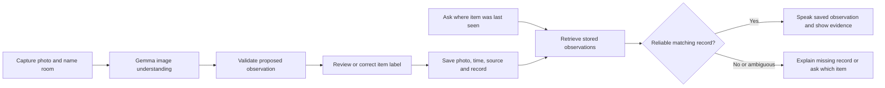

**Gemma hackathon: feasibility, scope, and demo review**

Scope update: the user subsequently chose to retain all features, prioritize four complete experiences, and target English/USD. Follow [App Product and Build Plan.md](<App Product and Build Plan.md>) for the current scope and build order. The research and technical caveats below remain relevant; its earlier feature-cut recommendations are superseded.

Prepared October 23, 2026, Pacific time. This review covers the full contents of [Hackathon Plan.html](<Hackathon Plan.html>) and [App Build Guide.html](<App Build Guide.html>), current organizer information, official runtime documentation and source, competing products, and the local development environment. Recommendations and time estimates below are engineering judgments, not organizer judging criteria or measured app performance.

**Decision: build one persistent, accessible visual-memory workflow on the iPhone.**

A three-to-four-person team can plausibly build a compelling working prototype during this event. The proposed six-feature assistant, two native apps, multiple models, background video processing, and hazard detection are too much to make dependable in that time. The meaningful uncertainty is whether a signed custom app can run the chosen multimodal model repeatedly on your actual phone with acceptable latency and memory use. Resolve that before committing the day to secondary features.

Your confirmed resources are a team of three or four, an iPhone, and downloaded **Gemma-4-E4B-it, approximately 3.66 GB, and EmbeddingGemma-2 inside Google AI Edge Gallery**. The supplied plans identify the phone as an iPhone 16 Pro Max. The exact phone hardware and installed iOS version have not been inspected. Team members' mobile-development experience and access to an Android device remain unconfirmed.

The proposed pitch is: **“A private memory for the things you put down: remember them, hear where they were last seen, and revisit the original evidence—even after restarting the app.”** Frame it as a prototype designed for blind and low-vision users. Do not claim validated accessibility without involving users.

**The event changes the plan.**

The current organizer data says building starts at **12:15 p.m.**, the finalist draft is due at **7 p.m.**, and final submission is **8 p.m.** on October 24. That leaves **6 hours 45 minutes** to the important draft cutoff. Demos are three minutes. Projects must be open source; extensions are allowed, but the demonstrated new work must be created at the event. Choose one main track. Mobile AI and the LiteRT special prize each offer $7,500/$5,000/$2,500. Android/Pixel Best in Show offers $15,000. No Accessibility prize, detailed weighted rubric, or guaranteed Pixel loaner was found. [Official event](https://www.agihouse.org/events/the-google-gemma-hardware-hackathon)

Gemma and entirely on-device execution are requirements. The organizer describes workbench judging followed by six stage finalists. Registration needs host approval. [Organizer's Luma listing](https://luma.com/6ccl0jw5)

The event page uses JavaScript; its public event data was checked directly through the endpoint used by that page, updated October 23. One submission paragraph conflicts with the earlier draft deadline; use the earlier cutoff. Research, toolchain preparation, and inspecting existing software are sensible preparation. Keep original event-day implementation and reused components distinguishable in the repository. No app code, event submission, or external publication was created during this research.

**Prize strategy follows the actual entry.**

Choose Mobile AI as the main track and pursue LiteRT as the additional fit. A phone is sufficient hardware for this entry. A second platform is valuable only when a competent developer and actual device can produce a dependable experience without delaying the primary one. An unconfirmed loaner should not determine the architecture.

The most persuasive evidence is a fresh capture chosen by a judge, an accurate retrieval with its source photograph, persistence after restart, a clear absent-item response, and observed device performance. This is my recommendation for demonstrating substance; there is no published rubric establishing how judges will weight these. Neither prize odds nor a win can responsibly be estimated from the available information.

**The competitive research changes the positioning.**

| Existing product | Verified overlap | Implication |
|---|---|---|
| Microsoft Seeing AI | Find My Things learns personal objects from short videos, personalizes on-device, and guides live finding with audio/haptics. | Personal object finding is established. Our proposed workflow emphasizes retained observations and history. [Microsoft Research](https://www.microsoft.com/en-us/research/story/find-my-things/) |
| Google Lookout | Text, documents, currency, image questions, predefined object finding, and downloadable offline food-label support. | Narration and reading alone offer limited differentiation. [Google Help](https://support.google.com/accessibility/android/answer/9031274?hl=en) |
| Be My AI | Requires internet; photos and chats are processed through OpenAI; unclear captures can trigger retake requests. | Offline processing is a real comparison point against this product. Refusal is already expected behavior. [Be My Eyes FAQ](https://support.bemyeyes.com/hc/en-us/articles/18133134809105-Using-Be-My-AI) |
| Google's LiteRT sample | Offline camera/voice interactions, scene-change sampling, semantic visual memory, evidence images, timestamps, and ambiguity/miss handling. Memory is session-local. | The original contribution must extend beyond camera description, retrieval, or refusal. [Sample architecture](https://raw.githubusercontent.com/google-ai-edge/litert-samples/main/samples/litert/flutter/docs/architecture.md) |

The sample is especially relevant because Google's engineers may recognize it immediately. Persistent, explicitly named and reviewable observations, retrieval after restart, corrections, deletion, and usable VoiceOver behavior form a more defensible original extension. This combination is a proposed product focus, not a verified world-first claim. Google's sample remains a useful implementation reference, with attribution.

**What to build—and what to postpone.**

| Feature in the supplied files | Technical assessment | Decision for this event |
|---|---|---|
| Scene narration | Feasible for a still photo; model output may be wrong. | Keep as the capture/understanding step. Limit output to one or two useful sentences. |
| Record and Find | Feasible as saved observations. Arbitrary video indexing, object identity, and present location are different problems. | Make this the central workflow. Start with 3–5 deliberate snapshots and a small inventory. |
| Voice interaction | Feasible with native speech and accessible controls, after offline support is checked. | Required: push-to-talk or tap-to-talk, stop, repeat, status, and button alternatives. |
| Ordinary reading | Feasible using local OCR with uncertainty handling. | Optional after memory works; use a sign, menu, or ordinary label. |
| Medicine, expiry, currency | Recognition errors can change important numbers; a prompt cannot guarantee correctness. | Exclude from the first demo. A generic OCR demonstration does not establish suitability for medication or money. |
| Hazard awareness / navigation | Requires sensor validity, coordinate handling, timing, failure detection, and careful validation. | Cut from the live prototype. A “hazard awareness” name does not eliminate these requirements. |
| Landmark visualization | A bounded factual-description experience is feasible. | Cut: it is disconnected from the central task and consumes demo time. |
| Calendar / reminders | A separate permission and interaction workflow is feasible. | Cut: it does not strengthen the memory story. |
| Email / messages | Direct access to other apps' databases differs from authorized provider integrations. | Cut. Do not justify the cut with a blanket claim that every email integration on iOS is impossible. |
| Background room-video indexing | Possible only with platform and resource limitations; not a reliable fixed-time background job. | Foreground capture only. Short video import is a stretch after all acceptance gates pass. |
| Second native app | Technically feasible, but requires its own integration, testing, and debugging. | Optional independent track after the primary phone works. |
| Always-on wake word / fine-tuning / custom conversion | Adds substantial integration or resource risk. | Outside event scope. |

A useful minimum product answers one complete question: **“What did I record about this item, and how old is that observation?”** It does not promise to know the current location of an object that moved outside the camera's view.

**How your Gallery downloads help.**

We can reuse the same model families, public weights, prompts, and testing lessons. Gallery itself is a test bench; it is not an automatically callable inference service for our app. iOS isolates app storage, so our app cannot simply open Gallery's private downloaded model. A supported export/import mechanism could transfer the bytes, but no documented iOS model export or shared inference API was established. [Apple platform security](https://support.apple.com/guide/security/security-of-runtime-process-sec15bfe098e/web), [Gallery repository](https://github.com/google-ai-edge/gallery)

Plan for a model file imported, copied over USB, or downloaded into our app's own container. Inspect Gallery's actual Files/export options before spending time trying to recover its copy. Do not depend on that option existing. Additional storage may be needed for the model's original and imported copies, runtime caches, photos, and the embedding model.

Test **E4B first** because it is the model you already selected, with **E2B as the planned fallback**. The published E4B file is 3.66 GB; its model card's benchmark excludes model loading and uses initialized caches and a bounded text workload. Those numbers do not establish photo-to-speech latency on your phone. The compiled model card describes up to 32K context; avoid allocating around the documents' blanket 128K assumption. [E4B model card](https://huggingface.co/litert-community/gemma-4-E4B-it-litert-lm)

Use a small context, short responses, one request at a time, and a fresh conversation for unrelated photos. Keep the model engine loaded while the app is active; avoid retaining unlimited image history. Choose E4B or E2B on observed task quality, repeated-call stability, and latency—not download size alone. A Gallery download is not yet evidence of successful offline image inference, and successful Gallery inference is not proof of identical custom-app memory behavior.

**EmbeddingGemma 2 is useful, but optional for the first working loop.**

Your installed model is version 2; the guide mostly describes version 1. Google's current integration uses LiteRT-LM `EmbeddingEngine`, including Swift, and task-specific query/document prefixes. The available family has text-only, text/vision, and broader multimodal variants; record the exact artifact before selecting an integration. [Embedding guide](https://developers.google.com/edge/litert-lm/embedding_models)

Initially, store explicit item names and aliases, then retrieve matching records ordered by observation time. That is enough for a small honest demo, provided fresh captures are really processed by Gemma. Later, embeddings can support descriptive queries such as “the thing I drink tea from” and retrieve source frames without demanding exact names. Similarity retrieval needs an explicit no-match outcome and ambiguity handling; the nearest vector is not necessarily the right object. Record embedding model/version/dimension and normalization with the index. Profile both models together before keeping both resident; switching models repeatedly also has a cost.

**The concrete iOS implementation route.**

Use SwiftUI, AVFoundation capture, Google's official `LiteRTLM` Swift package, native speech, and a small persistent store. Pin a tested version; the latest listed release checked was **0.18.1**, released October 20, including an EmbeddingGemma 2 ABI fix. [Release](https://github.com/google-ai-edge/LiteRT-LM/releases/tag/v0.18.1)

The Swift SDK supports image input and Metal. Configure the text backend and a vision backend explicitly; Google's example uses GPU for text and CPU for vision. Its documented API includes `EngineConfig`, `ConversationConfig(systemMessage:)`, image/text content, and streaming responses. No model conversion or Python inside the app is necessary. The overview still labels Swift Early Preview, so budget integration risk. [Swift API](https://developers.google.com/edge/litert-lm/swift), [SDK overview](https://developers.google.com/edge/litert-lm/overview)

The larger official Flutter demo has additional requirements, including Flutter/CocoaPods and a newer iOS dependency. Those are not the minimum requirements of the underlying native Swift package. Its iPhone guide discusses signing, model import, USB copying, and memory entitlements. Treat that as a useful troubleshooting reference, not a mandate to adopt its entire stack. [iPhone sample setup](https://raw.githubusercontent.com/google-ai-edge/litert-samples/main/samples/platforms/ios/README.md)

The proposed app has six small responsibilities:

| Module | Responsibility | Main failure to handle |
|---|---|---|
| Capture | One correctly oriented still, room label, capture time | Permission denied, blur, cancellation, no frame |
| Local inference | Serialize model requests and return bounded structured observations | Initialization failure, timeout, memory warning, invalid output |
| Observation store | Save item names, sources, image, time, and provenance atomically | Partial save, missing image, deletion during a pending request |
| Retrieval | Name/alias match initially; optional semantic candidate retrieval | No record, multiple plausible items, old observation |
| Speech/accessibility | Listen, announce, speak, stop, repeat; equivalent named buttons | Unavailable offline speech, audio interruption, VoiceOver overlap |
| Diagnostics | Record measured timings and errors without private content | Misleading “offline” or performance labels |

Store observations rather than overwriting a single location. Suggested fields are `observationID`, `itemLabel`, `aliases`, `roomLabel`, `locationText`, `capturedAt`, `photoPath`, `sourceType`, `reviewState`, `modelID`, and optional embedding metadata. Distinguish a user-provided name from a model-inferred attribute. A user's confirmation improves interaction but does not prove every generated visual claim is true.

Never store malformed model JSON as a successful searchable observation. Allow one repair attempt, then report capture failure. Preserve the source photo for review. If the model invents a location, placing that location in SQLite does not make it factual. For an old observation, always say “last seen”; for duplicate blue mugs, ask which one or show both observations. “Moved” can be known only from a new observation or user input. An unseen move must remain unknown.

For this prototype, atomic Codable JSON plus files is adequate; SQLite or SwiftData is also reasonable if a teammate already knows it. Choose one and avoid building database infrastructure that the demo does not need.

**Speech, reading, and privacy need explicit behavior.**

Check offline recognition capability before listening and require on-device recognition. If unsupported or assets are missing, use accessible controls and typed input. Do not silently switch to network recognition. [Apple Speech capability](https://developer.apple.com/documentation/speech/sfspeechrecognizer/supportsondevicerecognition), [offline request](https://developer.apple.com/documentation/speech/sfspeechrecognitionrequest/requiresondevicerecognition)

Use named buttons, large targets, readable transcripts, predictable VoiceOver focus, and a persistent stop/repeat control. Pause listening while the app speaks, so it does not recognize its own answer. Queue complete sentences rather than fragments. Announce meaningful states such as capturing, analyzing, saved, or failed. App TTS and VoiceOver should not both narrate every change. Test backgrounding, returning to the app, and audio interruptions.

Optional reading should use Apple Vision text recognition. It provides candidate text and confidence; it still makes mistakes. Preserve source text, use image-quality and parsing checks, and reject unsupported extracted fields. An LLM can structure text, but should not silently add digits or words. [Apple Vision OCR](https://developer.apple.com/documentation/vision/recognizing-text-in-images)

Keep photos, observations, embeddings, and temporary captures local; exclude sensitive application data from backup if claiming it stays on the phone. Avoid analytics uploads and private data in diagnostic logs. Delete the record, source photo, derived vectors, and temporary copies together; account for database journaling if used. Do not save home images to the system Photos library by default. “Delete” is application-level removal, not a claim of forensic secure erasure.

Show cellular and Wi-Fi disabled during the demonstration. Airplane mode can coexist with Wi-Fi. Test offline after closing and reopening the app, not just immediately after a connected session. Offline operation during a demo proves that workflow can work without connectivity; a stronger privacy claim also needs code inspection for later uploads and backup behavior.

**Corrections to the supplied build instructions.**

| Claim or conflict | Correction and consequence |
|---|---|
| iPhone is primary in one file; Android is flagship in the other | Use the confirmed iPhone. A loaner is a contingency. |
| Flutter shell versus two native apps | Choose a single primary implementation. Swift is the shortest verified local toolchain path here. |
| E2B default versus E4B default | You have E4B; try it first, then choose using custom-app measurements. |
| OCR-only reading versus sending the photo straight to Gemma | Use OCR and explicit source validation for the optional reading feature. |
| Cropped delta input versus full-scene input | These conflict. Start with deliberate full-frame still captures; cropping may remove essential context. |
| Fixed 80–90% compute savings | Unmeasured. Camera motion and exposure changes can trigger pixel differences. Report counted calls against a stated baseline only. |
| A cheap detector recognizes all important household objects | Standard COCO labels do not include keys. Do not gate the hero capture on that detector. [TensorFlow label map](https://raw.githubusercontent.com/tensorflow/models/master/research/object_detection/data/mscoco_label_map.pbtxt) |
| `litert-lm chat`, `run --model-path`, and shown import flags | They do not match the checked current CLI. Use the documented positional model argument and explicit backend options. [CLI guide](https://developers.google.com/edge/litert-lm/cli/usage) |
| Automatic equivalent Mac/phone performance | Metal support does not make thermals, memory, or image latency equivalent. Measure the phone. |
| A guaranteed Simulator CPU fallback and 5–10× slowdown | Not established by the checked sources. Use Simulator for UI, physical hardware for model acceptance. |
| Model files cannot be bundled | Too absolute: Google's Swift sample demonstrates bundling. Import/download is still preferable for large files and iteration. [Native sample](https://github.com/google-ai-edge/LiteRT-LM/tree/main/samples/ios_and_mac) |
| All Gemma 4 downloads require accepting a gated license | The checked Gemma 4 documentation specifies Apache-2.0, and the official E2B sample identifies a public download. Verify the exact file instead of assuming a gate. [Gemma 4](https://developers.google.com/edge/litert-lm/models/gemma-4) |
| EmbeddingGemma is a 308M `.task` drop-in | This mixes the older model with your version 2 installation and assumes unverified compatibility. Use the artifact's documented runtime. |
| Tightening prompts fixes every hallucination | Add validation and explicit failed states; retain errors in the evaluation results. |
| Platform speech is universally offline, free of downloads, and instant | Capability, language assets, permissions, and latency must be checked on the phone. |
| A phone cannot localize indoors at all | ARKit supports saved-world-map relocalization; dependable navigation remains far beyond this demo. [Apple world data](https://developer.apple.com/documentation/arkit/saving-and-loading-world-data) |
| Directional left/right haptics are a simple API parameter | Direction needs a learned pattern or another cue; it is an interaction design task. [Core Haptics](https://developer.apple.com/documentation/corehaptics) |
| Gmail inevitably requires months and a server | Google documents verification exceptions and conditions on assessments; provider integrations differ from reading Apple Mail's private database. Still cut email for focus and offline operation. [Google verification](https://developers.google.com/identity/protocols/oauth2/production-readiness/restricted-scope-verification) |
| Gallery is an equivalent fallback for the custom product | Gallery can show model ability, but does not demonstrate our original persistence and accessible workflow. Use a recording of our working app as the stronger fallback. |

**Work allocation for your team.**

| Owner | Work to protect | Integration boundary |
|---|---|---|
| You / product and device testing | Confirm scope, manage phone access, props, evaluation, narrative, and submission | Keep a running list of demonstrated behavior and outstanding failures |
| Mobile/runtime developer | Signed iPhone build, model import, inference queue, camera, performance | One async image-to-observation interface |
| Memory/accessibility developer | Persistent store, retrieval states, SwiftUI controls, speech coordination | A fixed observation schema agreed at the start |
| Fourth person, if available | Evaluation fixtures, documentation, demo recording; then embeddings or bounded Android proof | Optional work cannot block the primary app |

With three people, combine evaluation and demo ownership. Avoid assigning the fourth person a complete second app before the first one works. If nobody has Swift experience, treat the schedule as substantially higher risk; familiarity may justify extending an existing sample instead, while retaining a clear original contribution. Parallel development does not eliminate integration time or contention for the one physical phone.

**Build schedule: protect a complete demo before the draft.**

This is a proposed work plan anchored to the verified event schedule, not an organizer schedule.

| Local time | Outcome | Cut decision |
|---|---|---|
| 12:15–1:00 | Signed custom app loads model and answers a real photo; TTS works | If E4B is unstable, try E2B. No secondary feature work on the critical path. |
| 1:00–2:00 | Deliberate capture, room label, structured observation, source photograph | Keep only the reliable item classes and remove video import. |
| 2:00–3:00 | Durable save, retrieve, old-observation wording, absent/ambiguous results | This is the first complete product milestone. |
| 3:00–4:00 | Restart persistence, correction/deletion, VoiceOver and speech state handling | Freeze the primary architecture. |
| 4:00–5:00 | Run the test set, fix indexing and retrieval failures | Add semantic embeddings only if the core is already stable. |
| 5:00–6:00 | Repeated full demo, measurements, one optional ordinary-reading beat | Cut features that need an explanation to excuse failure. |
| 6:00–6:30 | Record the working app, prepare open-source README and entry | Finish a useful draft with real results; leave a buffer. |
| 6:30–7:00 | Verify draft and links, rehearse judge interaction | No new feature integration. |
| 7:00–8:00 | Fix only demo-breaking issues, final submission and device preparation | Preserve a known working build. |

If there is no working custom multimodal path by approximately 1:15, use a bounded recovery window with the smaller model or a known official sample. If none works, clearly label any reduced demonstration; do not replace live indexing with canned answers while claiming the original app succeeded. If retrieval is shaky by mid-afternoon, reduce to a handful of explicit names and alias matches. If embeddings hurt stability, remove them. The fallback ladder should simplify the implementation while preserving honest evidence.

**A three-minute demonstration with one story.**

| Time | Demonstration |
|---|---|
| 0:00–0:20 | Explain the everyday problem, show the phone is offline, state the last-seen limitation. |
| 0:20–0:55 | Let a judge place a rehearsed class of object near a landmark; capture it and show actual indexing completion. |
| 0:55–1:20 | Turn the camera away. Ask about the item. Hear the recorded location and timestamp; show the evidence photo. |
| 1:20–1:45 | Reopen the app and retrieve the saved observation. Retrieval should work without waiting for a new image analysis. |
| 1:45–2:10 | Ask about an unrecorded item, or show duplicate-item ambiguity. Demonstrate a clear missing/ambiguous result. |
| 2:10–2:35 | Use VoiceOver stop/repeat and correct or delete an observation. Re-query to prove the change. |
| 2:35–3:00 | Show measured device timings and test outcomes; identify the original event-day work and roadmap. |

Keep the actual AI work visible. If a fixture was prepared earlier, label it as prepared. Use a video of the same working custom app as contingency. Gallery can explain underlying model capability, but cannot stand in for unimplemented product behavior. A short sign-reading extension belongs in workbench questions only if it already passes its tests; the main stage story has enough content.

**Acceptance tests and measurements.**

The first device gate is a signed app, three different photo questions, spoken output, a cold offline restart, and repeated inference without a crash. A useful proposed target is first useful narration within about five seconds when warm, with a visible analyzing state immediately. This is an acceptance target, not a prediction. If the observed delay is larger, shorten outputs, compare E2B, or redesign the pacing. Database retrieval should remain responsive without running Gemma again.

Run a compact 20-case set: four ordinary memory cases, four missing/stale cases, four ambiguous or poor-capture cases, four operational cases, and four optional reading cases. If reading is cut, replace those four with more memory cases. Include similar mugs, a partly hidden item, a dark frame, an unseen object move, restart, denied microphone access, and deletion followed by re-query.

For each case record input, expected behavior, actual result, evidence record, and timing. Keep these outcomes separate: correct answer, correct refusal, wrong answer, unnecessary refusal, incomplete result, runtime failure. Never combine refusal and correctness into an invented safety percentage. A small curated regression set is not validation for generalized use by blind people.

Measure model initialization, photo-to-first-text, photo-to-first-speech, full indexing time, retrieval time, memory warnings, and repeated-call degradation. Report median and worst observed delay with sample count; do not manufacture a meaningful percentile from a handful of runs. Run the complete demo at least three times, including once after offline restart and once with a warmer phone. Keep test photos and expected values outside the production retrieval index unless intentionally imported and labeled.

**Local readiness and what I can actually implement.**

Verified on this Mac: Apple M4 Pro with 48 GB memory, Xcode 27.1, iOS 27.1 SDK, installed simulator runtimes, and ample disk space. `uv` and Python are available. Flutter, Dart, CocoaPods, and `adb` were not found on the current PATH; that does not prove they are absent elsewhere. No physical device was listed by Xcode when checked. Initial sandbox device-service errors were resolved by a read-only check outside the sandbox; they were not evidence of a broken Xcode installation.

I can create the Swift project, integrate the runtime, implement camera/inference/persistence/voice flows, write focused tests for observation validation and retrieval, build and diagnose errors, and prepare the repository and demo documentation. You will handle device unlocking/trust/Developer Mode, Apple-account interaction when needed, and real-world capture and accessibility feedback. Signing and provisioning still need to be proven with the phone attached.

No models were downloaded, no SDK was compiled, and no custom-app inference was run in this research. Source verification establishes an implementation route, not runtime completion. Gallery's exact offline image behavior, the custom app's memory entitlement needs, and E4B-plus-EmbeddingGemma-2 coexistence remain to be tested.

Before the event, confirm a fresh **Ask Image** request works in Gallery with cellular and Wi-Fi off; preserve the exact model identifiers; arrange access to the public `.litertlm` files; pair the iPhone with Xcode; and bring the cable, charger, and demo props. Use the event build period for the original implementation.

**After the hackathon.**

The next product milestone should be testing with blind and low-vision people: whether capture instructions are usable, whether recording items is too much work, whether last-seen answers actually help, and how corrections and forgotten observations should behave. Then expand object identity, multilingual speech, robust persistence, data controls, resumable foreground indexing, and device coverage. Consider background processing only after the core is useful. Hazard detection and navigation would be separate substantial research and validation efforts.

The credible commitment is a narrow, original, demonstrated prototype with explicit limits. Its strongest evidence will be the fresh observation it remembers correctly—not the number of modes on its home screen.
